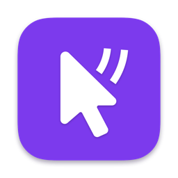
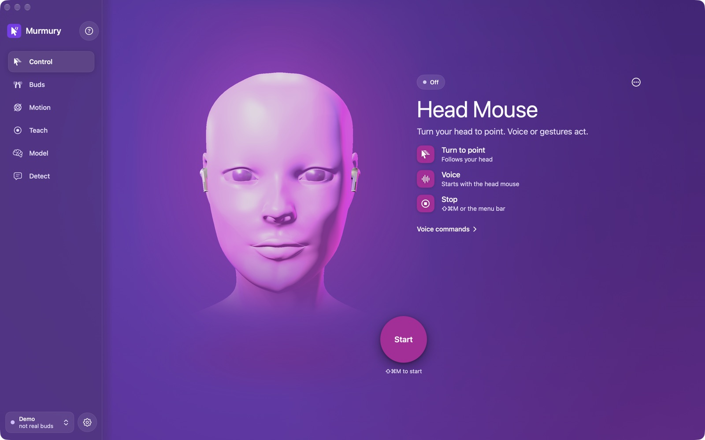
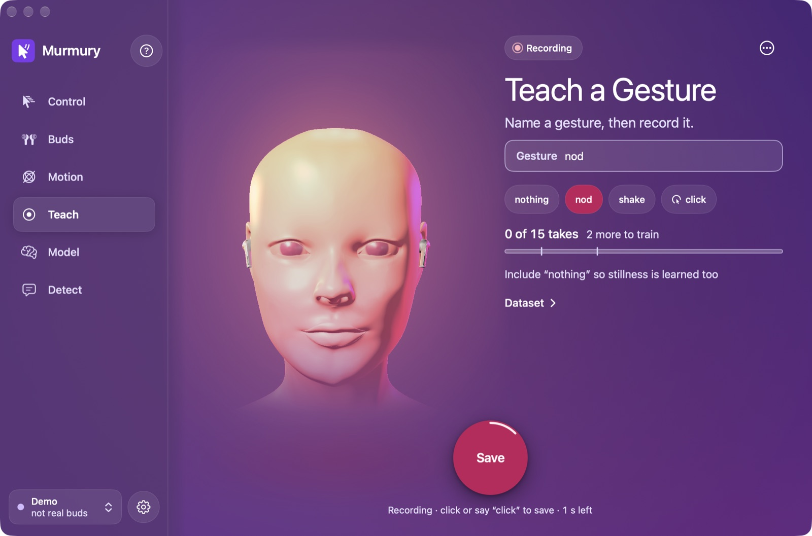
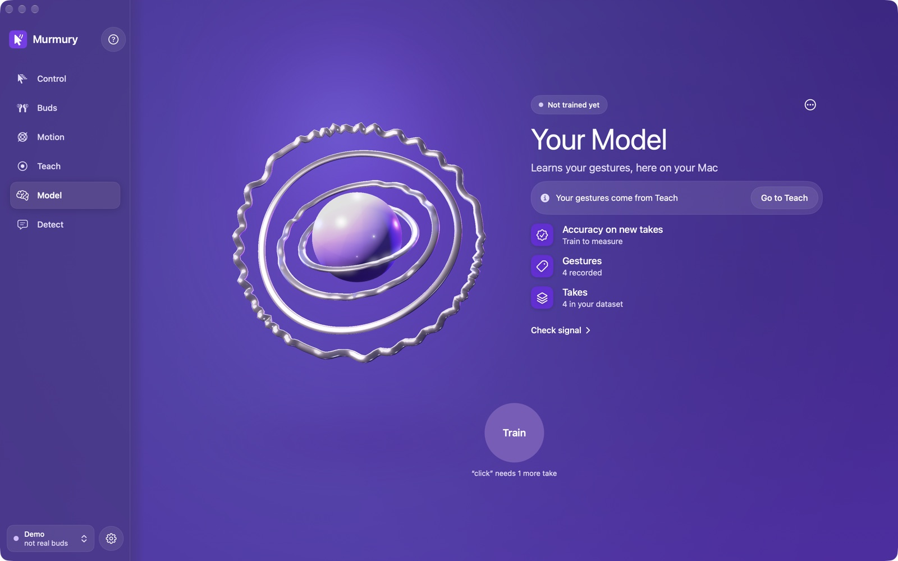
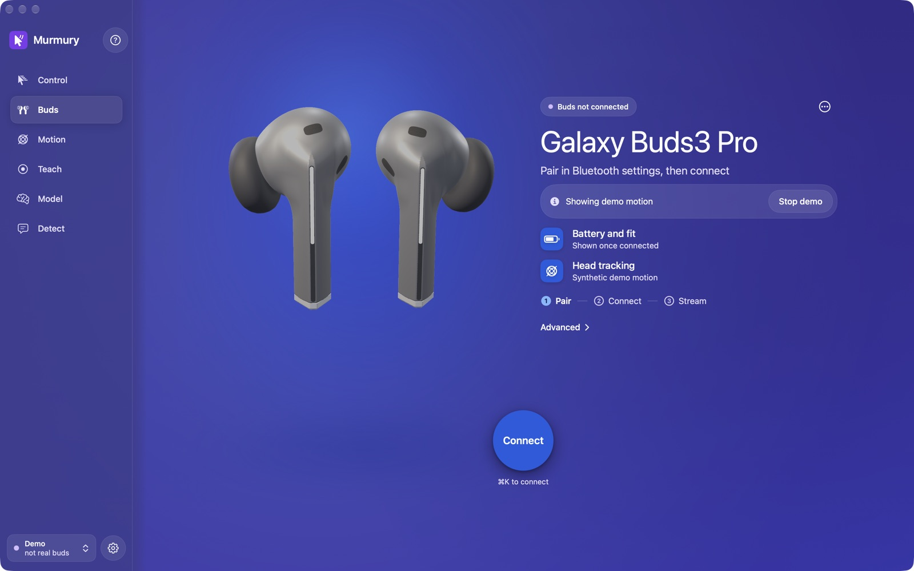

<div align="center">



# Murmury: Galaxy Buds3 Pro Head Mouse for Mac

**Use your Samsung Galaxy Buds3 Pro as a hands-free mouse on macOS.**
Turn your head to move the pointer, say *"click"* to click. No camera tracking, no extra hardware,
no cloud.

[](https://github.com/geekyshubham/Murmury/releases/latest)


</div>

---

## Demo

<video src="https://github.com/geekyshubham/Murmury/raw/main/docs/media/murmury-demo.mp4" poster="docs/media/poster.jpg" controls muted playsinline width="100%"></video>

<p align="center"><sub>Video not playing? <a href="docs/media/murmury-demo.mp4">Watch the 22-second demo (MP4)</a>.</sub></p>

---

## What is Murmury?

Murmury is a free, open-source macOS app that turns **Samsung Galaxy Buds3 Pro** earbuds into a
**head-tracking mouse**. The buds have a head-motion sensor (the one Samsung uses for 360 Audio). Murmury
reads it over Bluetooth, so you can **control your Mac hands-free**:

- **Head mouse.** Turn your head and the pointer follows. Say *"scroll mode"* and head movement scrolls instead.
- **Voice commands.** *"click"*, *"right click"*, *"double click"*, *"drag"* / *"drop"*, *"scroll down"*,
  *"mouse off"*. Speech recognition runs on-device on Macs that support it.
- **Your own gestures.** Record a nod, a shake or a head tilt, then train a small model **on your Mac**
  (Create ML) and use it to act.
- **Private by design.** No account, no analytics, no camera watching you. Head motion and your gesture model never leave your Mac. The webcam is used once, for an
  optional calibration of how the buds sit on your head.

It's built for **accessibility first**: people who can't, or would rather not, use a mouse or
trackpad (motor impairments, RSI, hands busy). It's also a fun tool for anyone who wants to teach their Mac
their own head gestures.

> **Think "AirPods head tracking as a mouse", but for Samsung Galaxy Buds on a Mac.** Apple exposes AirPods head
> motion through `CMHeadphoneMotionManager`. Samsung offers no Mac API for Galaxy Buds, so Murmury speaks the
> buds' own Bluetooth protocol directly.

## Screenshots

<table>
  <tr>
    <td width="50%"></td>
    <td width="50%"></td>
  </tr>
  <tr>
    <td align="center"><b>Head Mouse</b>: turn to point, speak to act</td>
    <td align="center"><b>Teach</b>: record your own gestures</td>
  </tr>
  <tr>
    <td width="50%"></td>
    <td width="50%"></td>
  </tr>
  <tr>
    <td align="center"><b>Your Model</b>: trained on your Mac</td>
    <td align="center"><b>Buds</b>: connection, battery, sensors</td>
  </tr>
</table>

## Supported devices

| Device | Status |
|---|---|
| **Samsung Galaxy Buds3 Pro** | ✅ Supported, verified on hardware |
| Galaxy Buds3, Buds2 Pro, Buds FE | ❔ Not tested. They may share the protocol; reports welcome |
| Galaxy Watch 6 Classic | 🧭 Planned as a second input device |
| AirPods / AirPods Pro | ➡️ See [Subvox](https://github.com/joeblau/subvox) |

Requires a Mac running **macOS 14 Sonoma or later**. The current release build is for **Apple silicon (arm64)**.

## Install

1. Download **`Murmury-<version>-macos-arm64.zip`** from the [latest release](https://github.com/geekyshubham/Murmury/releases/latest)
   and unzip it.
2. Move **Murmury.app** to `/Applications`.
3. The app isn't notarized yet, so macOS blocks the first launch. Either right-click the app › **Open** › **Open**,
   or run:
   ```sh
   xattr -dr com.apple.quarantine /Applications/Murmury.app
   ```
4. On first run, grant the permissions Murmury asks for: **Bluetooth**, **Microphone**, **Speech Recognition**,
   **Accessibility** (to move the pointer, click and scroll) and **Camera** (one-time calibration only).

No buds handy? Launch with `--demo` to try the app with synthetic head motion:
`/Applications/Murmury.app/Contents/MacOS/Murmury --demo`

## Quick start

1. **Pair** the Galaxy Buds3 Pro in **System Settings › Bluetooth**. If they're connected to your phone,
   disconnect them there first.
2. **Buds.** Open Murmury and connect. Live battery, wear state and sensor data appear.
3. **Control.** Press **Start** (or **⇧⌘M**). Turn your head to move the pointer and say *"click"*.
   Say *"mouse off"*, press **⇧⌘M** again or use the menu-bar item to stop at any time.
4. **Teach** *(optional).* Pick a label, record about 15 takes per gesture, and always include `nothing`
   so stillness is learned too.
5. **Model** *(optional).* *Check signal* tells you honestly whether your gestures are learnable. *Train*
   (⌘↩) builds a Create ML activity classifier on your data only.
6. **Detect.** Run your model live and see detections next to the mic transcript.

### Voice commands

| Say | Does |
|---|---|
| "click" / "left click" | Left click |
| "right click" | Right click |
| "double click" | Double click |
| "drag" … "drop" (or "let go") | Click-and-drag |
| "scroll up / down / left / right" | Scroll once |
| "scroll mode" / "pointer mode" | Head movement scrolls / points |
| "mouse off" / "mouse on" | Pause / resume the head mouse |

## How it works

```
Galaxy Buds3 Pro ──Bluetooth SPP (RFCOMM)──▶ Murmury
   head orientation quaternion                ├─ pointer: head angle → cursor motion (CGEvent, needs Accessibility)
   + raw gyro & accelerometer, ~50 Hz         ├─ voice: on-device speech recognition → mouse commands
                                              └─ gestures: features → Create ML classifier → actions
```

The Buds3 Pro stream a head-orientation quaternion plus raw gyroscope and accelerometer data at about 50 Hz
over Samsung's SPP protocol. Murmury reverse-engineered that protocol from Samsung's Buds3 Pro plugin and
cross-checked it against [GalaxyBudsClient](https://github.com/timschneeb/GalaxyBudsClient). The full write-up
is in [`research/FINDINGS_transport.md`](research/FINDINGS_transport.md) and
[`research/FINDINGS_samsung_sensors.md`](research/FINDINGS_samsung_sensors.md).

<details>
<summary><b>What the buds expose</b> (protocol details)</summary>

| Signal | How | Notes |
|---|---|---|
| Orientation quaternion (GRV) | `0xC2` sub `0x20`, after `C3 00` attach + `C3 04` keep-alive every 2 s | scalar-first, int16/10000, flag byte = which bud |
| Bud accelerometer + gyro | same message, 37-byte extended form | int32/2^25 and int32/2^26 |
| Unbatched streaming | `C3 08` | otherwise the bud batches samples, ~1 sample/s when the head is still |
| Raw accelerometer ≈50 Hz | `C7 04 01` → `0xC6` records | neck-calibration channel; experimental toggle |
| Wear, battery | `0x60` / `0x61`, `0xC2 21/22` | |
| Voice pickup (bone conduction) | `0x26` one-shot debug snapshot only | not streamable |

</details>

### What to expect

- **Head pointing, scrolling and voice clicks** work out of the box.
- **Head gestures** (nods, shakes, tilts, talking vs. not, chewing) are well within reach of a model you train yourself.
- **Small mouthed-word vocabularies** may work, depending on how much your jaw moves your head; *Check signal* tells you.
- **Open-vocabulary "silent speech" from head motion isn't realistic** with this signal. For full speech, Murmury uses on-device speech recognition.

## Build from source

Needs macOS 14+ and the Xcode Command Line Tools (full Xcode isn't required).

```sh
git clone https://github.com/geekyshubham/Murmury.git && cd Murmury
scripts/make-signing-cert.sh    # once: a stable local signing identity keeps macOS permissions across rebuilds
scripts/build-app.sh --run      # build build/Murmury.app, sign it and open it
scripts/test.sh                 # full test suite (swift-testing), incl. on-device model training
scripts/test.sh --filter "SPP"  # one suite
```

To skip the certificate, build ad-hoc with `MURMURY_ALLOW_ADHOC=1 scripts/build-app.sh`. Permissions you
grant are then lost on the next rebuild. Launch options: `--demo` (synthetic motion, no buds needed).

Data lives in `~/Library/Application Support/Murmury/` (takes + model) and `~/Documents/Murmury/Sessions/`
(raw recordings, ⌘R).

<details>
<summary><b>Project layout</b></summary>

```
Sources/MurmuryKit/Buds      SPP codec, message parser, session state machine, IOBluetooth transport
Sources/MurmuryKit/Motion    kinematics, sample clock, pipeline, segmenter, demo motion
Sources/MurmuryKit/Pointer   head-to-pointer mapping, voice command parser, click/scroll injection
Sources/MurmuryKit/ML        features, DTW templates + evaluation, Create ML trainer/runner
Sources/MurmuryKit/Audio     mic capture and on-device transcription
Sources/MurmuryKit/Views     SwiftUI screens, 3D head and buds
Tests/MurmuryTests           swift-testing suites (run as the `murmury-tests` executable)
research/                    protocol findings
```

</details>

## FAQ

<details>
<summary><b>Can I use Galaxy Buds as a mouse on a Mac?</b></summary>
Yes. With Murmury, Galaxy Buds3 Pro control the Mac pointer with head movement, and voice commands click and scroll.
</details>

<details>
<summary><b>Does Galaxy Buds head tracking work on macOS?</b></summary>
Not through any Samsung or Apple API. Murmury connects to the buds over Bluetooth and enables their head-tracking
sensor stream directly, the same sensor Samsung uses for 360 Audio on Galaxy phones.
</details>

<details>
<summary><b>Is this a hands-free mouse alternative for accessibility?</b></summary>
That's the main goal: a hands-free way to use a Mac for people with motor impairments, RSI, or busy hands.
It works alongside macOS features such as Voice Control and Head Pointer, and uses earbuds instead of a camera.
</details>

<details>
<summary><b>Does it send my voice or motion data anywhere?</b></summary>
Head motion, recordings, gesture training and detection stay on your Mac; Murmury has no account, analytics or servers of its own. Voice commands use Apple's speech recognizer, which runs on-device on Macs that support it (Apple Silicon with the language downloaded); on others, Apple's recognizer may use Apple's servers.
</details>

<details>
<summary><b>Does it work with AirPods?</b></summary>
Murmury targets Galaxy Buds. For AirPods head motion on macOS, see <a href="https://github.com/joeblau/subvox">Subvox</a>, which Murmury builds on.
</details>

## Credits

- [Subvox](https://github.com/joeblau/subvox) by Joe Blau: the AirPods original. Murmury's audio capture and parts
  of its plotting are adapted from it (MIT). See [THIRD_PARTY_NOTICES.md](THIRD_PARTY_NOTICES.md).
- [GalaxyBudsClient](https://github.com/timschneeb/GalaxyBudsClient) by Tim Schneeberger: the reference for the Galaxy Buds protocol.

Not affiliated with or endorsed by Samsung or Apple. Galaxy Buds is a trademark of Samsung Electronics.

---

<div align="center">
<sub>Keywords: Galaxy Buds3 Pro mouse · head mouse for Mac · hands-free mouse macOS · head tracking mouse ·
earbuds head tracking · Samsung Galaxy Buds Mac app · accessibility mouse alternative · voice click Mac</sub>
<br/><br/>
If Murmury helps you, please ⭐ the repo so others can find it.
</div>
